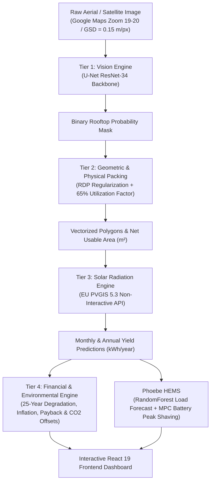
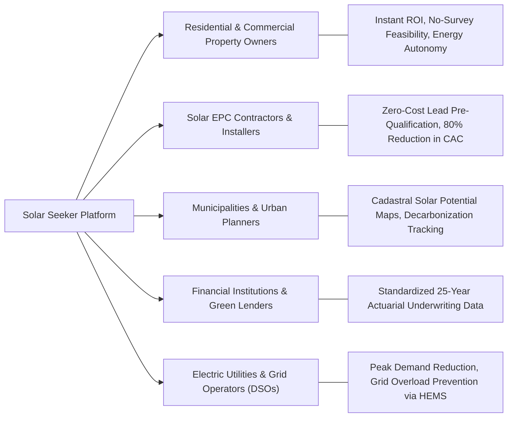
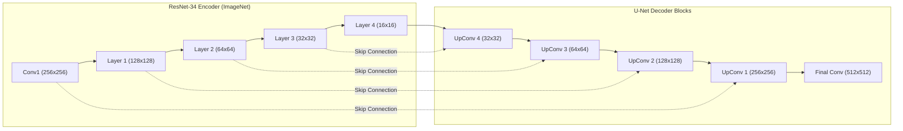
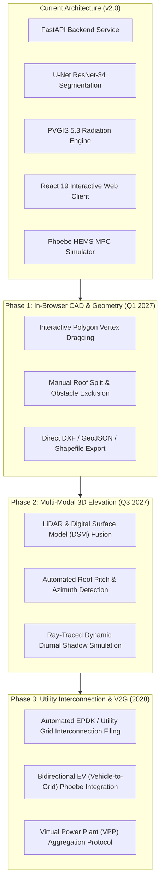

# Solar Seeker: Automated AI-Driven Rooftop Photovoltaic Assessment & Smart Energy Management Platform

**Document Version:** `2.0.0`  
**Date:** October 2026  
**System Calibration Benchmark:** Beylikdüzü, Istanbul (Lat 41.0026, Lon 28.6417)  
**Author / Engineering Team:** Solar Seeker Core Architecture Group  

---

## Executive Summary

The global transition to decentralized, renewable energy demands rapid, accessible, and high-accuracy tools to evaluate rooftop solar photovoltaic (PV) viability. **Solar Seeker** is an automated, AI-driven urban rooftop assessment and energy management platform. By synthesizing computer vision, satellite remote sensing, European Commission PVGIS radiation physics, 25-year lifecycle financial actuarial models, and an intelligent Home Energy Management System (**Phoebe HEMS**), Solar Seeker closes the gap between raw aerial imagery and actionable rooftop investment decisions. 

---

## 1. Problem and Motivation

### 1.1 The Urban Renewable Energy Bottleneck
Urban environments account for over 70% of global greenhouse gas emissions and roughly two-thirds of worldwide energy consumption. Rooftop photovoltaic systems represent the largest untapped decentralized clean energy reservoir available to cities. However, the adoption curve remains bottlenecked by high friction across the customer acquisition, site assessment, and engineering design pipeline:

1. **High Soft Costs & Customer Acquisition Costs (CAC):** In the residential and commercial solar industry, "soft costs" (customer acquisition, site surveying, permitting, and preliminary system design) account for **25% to 35% of total installation CapEx**. Traditional workflows require specialized field engineers to travel to physical sites with ladders, measuring tapes, or localized drone surveys.
2. **Information Asymmetry & Technical Hesitation:** Property owners, building managers, and tenants face steep technical barriers. Sizing formulas, tilt angles, inverter efficiencies, shading losses, and utility tariff schedules create uncertainty, resulting in decision paralysis and low conversion rates.
3. **Flawed Manual CAD Tooling:** Existing remote assessment tools often rely on manual polygon tracing over satellite images or overly simplistic square-footage approximations that ignore realistic physical setback constraints, fire pathways, parapets, and maintenance corridors.
4. **The "Generation Without Management" Deficit:** Installing solar panels without intelligent load balancing often causes energy mismatches. Peak solar generation occurs during midday (11:00–14:00) when residential occupancy is lowest, while household electricity demand surges during evening hours (17:00–22:00) when grid tariffs reach their most expensive peak rates. Without an automated, intelligent battery dispatch mechanism, solar system owners export surplus energy at low wholesale rates and repurchase grid electricity at punitive peak rates.

### 1.2 Motivation of Solar Seeker
Solar Seeker was conceived to democratize rooftop solar intelligence. By transforming any standard satellite screenshot into an audit-grade engineering and financial assessment within seconds, the platform eliminates preliminary surveying expenses, standardizes feasibility calculations, and couples solar generation directly with intelligent battery storage dispatch.

---

## 2. The Proposed Solution

Solar Seeker operates via a decoupled 4-tier pipeline coupled with an autonomous energy management module:

### 2.1 Tier 1: Computer Vision Engine (Deep Rooftop Segmentation)
The platform ingests aerial or satellite RGB imagery (calibrated to a Ground Sample Distance, $\text{GSD} = 0.15\text{ m/px}$). A custom-trained **U-Net** deep convolutional network with a pre-trained **ResNet-34 backbone** processes images standardized to $512 \times 512$ tiles to generate a high-confidence binary segmentation mask identifying rooftop footprints.

### 2.2 Tier 2: Geometric Regularization & Physical Packing Engine
Raw neural network predictions exhibit natural raster noise and organic curves that do not reflect architectural reality. Tier 2 applies:
- **Ramer-Douglas-Peucker (RDP) Regularization (`cv2.approxPolyDP`):** Snaps organic contour perimeters into crisp, structural geometric polygons with minimal vertices.
- **Physical Area Calibration:** Converts pixel areas into real-world square meters ($m^2$) based on the sensor Ground Sample Distance:
  $$\text{Gross Area } (m^2) = \text{Pixel Count} \times \text{GSD}^2$$
- **The Empirical 65% Utilization Factor ($k = 0.65$):** Literature and solar engineering codes mandate setbacks from roof edges, fire corridors, structural vents, and maintenance pathways. Solar Seeker applies a standard 65% packing factor to derive Net Usable Solar Area:
  $$\text{Net Usable Area } (m^2) = \text{Gross Footprint } (m^2) \times 0.65$$
- **Capacity Sizing:** Assuming modern Tier-1 monocrystalline silicon panels ($400\text{ W}$ per $2.0\text{ m}^2$, yielding a panel density of $0.20\text{ kWp}/m^2$):
  $$\text{Peak Capacity } (kWp) = \text{Net Usable Area } (m^2) \times 0.20\text{ kWp}/m^2$$

### 2.3 Tier 3: Solar Radiation Physics Engine (PVGIS Integration)
Rather than using static regional averages, Solar Seeker connects directly to the European Commission’s **PVGIS 5.3 API** (`/PVcalc` endpoint). Given the precise latitude, longitude, and calculated $kWp$:
- Computes monthly and annual solar irradiance, optimal pitch/tilt angle ($\theta^\circ$), and system losses ($14\%$ standard derating accounting for cabling, inverter clipping, soiling, and ambient temperature degradation).
- Implements an automated physics-based mathematical fallback estimator if API connectivity is restricted, ensuring uninterrupted platform availability.

### 2.4 Tier 4: Actuarial Financial & Environmental Engine
Solar Seeker generates a realistic 25-year lifecycle cash flow schedule that incorporates:
- **0.5% Annual Panel Degradation:** Modeled as $Y_t = Y_0 \times (1 - 0.005)^{t-1}$.
- **4.0% Utility Tariff Escalation:** Reflects compounding grid energy price inflation.
- **0.5% Annual Operations & Maintenance (O&M):** Scaled with inflation.
- **Inverter Replacement at Year 11:** Factoring in capital replacement costs ($12\%$ of initial CapEx).
- Exact linear interpolation to calculate the break-even payback period and net 25-year ROI.
- Real-time environmental calculations estimating avoided metric tonnes of $CO_2$ and equivalent trees planted.

### 2.5 Phoebe HEMS: Autonomous Energy Storage & Peak-Shaving System
Solar Seeker integrates **Phoebe**, an AI-powered Home Energy Management System (HEMS):
- Utilizes a **RandomForestRegressor** trained on continuous household smart-meter consumption data.
- Executes an autonomous **Model Predictive Control (MPC)** battery dispatch algorithm over a rolling horizon (120 to 300 minutes).
- Proactively rations battery discharge during high-demand evening windows (17:00–22:00 peak tariff), shaving power spikes above $1.65\text{ kW}$ and preventing premature battery depletion.

---

## 3. Target Users and Stakeholders

### 3.1 Residential and Commercial Property Owners
- **Pain Point:** Lack of transparent, vendor-neutral estimates; fear of lengthy payback horizons.
- **Value Proposition:** Upload a screenshot or click their building to receive instant, verifiable capacity, annual savings, bill offset percentages, and interactive 3D/2D polygon verification with zero sales pressure.

### 3.2 Solar EPCs (Engineering, Procurement, Construction) and Installers
- **Pain Point:** Spending days preparing manual quotes for unvetted leads with high drop-off rates.
- **Value Proposition:** Reduces preliminary engineering time from hours to seconds. Acts as a high-conversion automated lead qualification funnel.

### 3.3 Municipalities, Governments, and Urban Planners
- **Pain Point:** Setting clean energy targets without accurate cadastral rooftop capacity data.
- **Value Proposition:** Enables district-wide or city-wide solar potential scanning, helping municipal leaders identify prime public and private rooftops for clean energy incentives and urban microgrids.

### 3.4 Financial Institutions, ESG Investors, and Green Lenders
- **Pain Point:** Difficulty validating green loan applications and verifying projected payback schedules.
- **Value Proposition:** Transparent, audit-grade 25-year cash flow models that include degradation and maintenance schedules, enabling standardized underwriting for solar mortgages and green leases.

### 3.5 Distribution System Operators (DSOs) and Utilities
- **Pain Point:** Severe grid instability and transformer stress caused by uncontrolled evening peak demand and uncontrolled solar injection.
- **Value Proposition:** Phoebe HEMS demonstrates how decentralized battery storage with MPC peak-shaving smooths household load profiles, relieving distribution feeder congestion.

---

## 4. AI Technology and Methodology

### 4.1 Vision Model Architecture: U-Net with ResNet-34 Encoder
The rooftop segmentation model is built using an encoder-decoder architecture:
- **Encoder Backbone:** ResNet-34 pre-trained on ImageNet. Its residual skip connections mitigate vanishing gradients while extracting low-level edge features and high-level structural semantics.
- **Decoder Highway:** Expansive convolutional blocks with transpose convolutions and bilinear upsampling, combined with lateral skip connections from the encoder to retain precise pixel-level boundaries.
- **Standardized Dimensioning:** Neural networks with 5 downsampling stages require dimensions divisible by $2^5 = 32$. Inputs are standardized to $512 \times 512 \times 3$, inferenced, and bicubic-upsampled back to original input dimensions.

### 4.2 Loss Function Formulation
To address class imbalance (where rooftops occupy only a fraction of the total satellite image area), the model is optimized using a compound loss function:

$$\mathcal{L}_{\text{total}} = \alpha \mathcal{L}_{\text{BCE}} + \beta \mathcal{L}_{\text{Dice}}$$

Where:
$$\mathcal{L}_{\text{BCE}} = -\frac{1}{N} \sum_{i=1}^N \left[ y_i \log(\hat{y}_i) + (1 - y_i) \log(1 - \hat{y}_i) \right]$$
$$\mathcal{L}_{\text{Dice}} = 1 - \frac{2 \sum_{i=1}^N y_i \hat{y}_i + \epsilon}{\sum_{i=1}^N y_i + \sum_{i=1}^N \hat{y}_i + \epsilon}$$

With $\alpha = 0.5$, $\beta = 0.5$, and Laplace smoothing parameter $\epsilon = 1.0$.

### 4.3 Training Methodology & Dataset Unification
1. **Multi-Source Dataset Integration:**
   - **Inria Aerial Image Dataset:** 360 ortho-rectified aerial tiles ($5000 \times 5000$ at $0.30\text{ m/px}$) covering diverse urban typologies (Austin, Chicago, Vienna, Tyrol).
   - **Calibrated Beylikdüzü Dataset:** High-resolution aerial imagery from Istanbul (original $\text{GSD} = 0.135\text{ m/px}$, downsampled to a unified $0.30\text{ m/px}$).
   - **Tiling & Stride:** Sliced into $512 \times 512$ tiles with a 64-pixel overlap to avoid boundary artifacts.
2. **Hard Negative Mining:** Including tiles containing zero rooftops (highways, open fields, asphalt parking lots, water bodies) to prevent false positive detections.
3. **Albumentations Augmentation Pipeline:**
   - Horizontal and Vertical Flips ($p = 0.5$).
   - Random 90-degree Rotations ($p = 0.5$).
   - Color Jitter (Brightness $\pm 15\%$, Contrast $\pm 15\%$, Saturation $\pm 10\%$).
   - ImageNet Channel Normalization ($\mu = [0.485, 0.456, 0.406]$, $\sigma = [0.229, 0.224, 0.225]$).

### 4.4 Vector Regularization via RDP Algorithm
Thresholding probabilities at $p \ge 0.5$ generates raster masks. Contours are simplified using the Ramer-Douglas-Peucker algorithm:

$$\epsilon = \kappa \times \text{Perimeter}(\mathcal{C}), \quad \text{where } \kappa = 0.015$$

Polygons with physical area $< 35\text{ m}^2$ are filtered out as non-viable micro-structures (e.g. storage sheds, vehicle canopies).

### 4.5 Phoebe HEMS: Machine Learning & Model Predictive Control (MPC)
Phoebe optimizes home energy dispatch through a two-stage approach:
1. **Autoregressive Load Forecasting:** A trained `RandomForestRegressor` takes features:
   $$\mathbf{x}_t = [\text{hour}_t, \text{day}_t, \text{demand}_{t-60}, \text{rolling\_mean}_{t-180}]$$
   A cyclic residual synthesis layer preserves peak household dynamics (e.g., cooking, heating pulses).
2. **Dynamic MPC Dispatch Decision Policy:**
   - **Surplus Budget Calculation:** If forecasted demand $\le$ remaining battery state-of-charge ($\text{SoC}$), full inverter power is allowed.
   - **Rationing Mode:** When battery capacity is constrained, Phoebe sets a dynamic ceiling to shave high-cost demand spikes above $1.65\text{ kW}$ while conserving battery charge during baseline valleys, preventing premature battery exhaustion.

---

## 5. Innovation and Originality

| Dimension | Conventional Solar Tools | Solar Seeker Platform |
| :--- | :--- | :--- |
| **Workflow Scope** | Disjointed: manual CAD tools or single-purpose calculators. | **Full-Stack 4-Tier Integration:** Vision $\to$ Geometry $\to$ Radiation Physics $\to$ Financials $\to$ HEMS Battery Dispatch. |
| **Obstacle Handling** | Naive 2D obstacle segmentation resulting in false positives from roof vents. | **Empirical Utilization Factor ($k = 0.65$):** Reflects physical fire codes and maintenance access without over-segmentation. |
| **Shadow Treatment** | Rigid shadow subtraction that removes sunlit afternoon roof area. | **Dynamic System Derating ($14\%$):** Retains full roof polygons and accounts for shading inside validated radiation physics. |
| **CAD Export & UI** | Flat static raster outputs or manual click-and-drag tracing. | **Automated RDP Vectorization:** Interactive, selectable polygons rendered instantly in the browser. |
| **Storage Synergy** | Solar-only yield estimation without storage dispatch. | **Phoebe HEMS Co-Design:** Integrated machine learning load forecasting with real-time MPC peak-shaving. |
| **Economic Calibration** | Generic worldwide averages with static electricity rates. | **Actuarial 25-Year Lifecycle Cashflow:** Incorporates panel degradation, tariff escalation, O&M, and Year-11 inverter replacement. |

---

## 6. Environmental and Sustainability Impact

### 6.1 Direct Carbon Mitigation
Solar Seeker quantifies environmental offsets using localized grid emission factors. For Turkey's electric grid ($0.40\text{ kg } CO_2 / \text{kWh}$ avoided):

$$\text{Annual } CO_2 \text{ Offset (Tonnes)} = \frac{\text{Annual Yield (kWh)} \times 0.40}{1000}$$

#### Real-World Benchmark (Tested Sample: Beylikdüzü Residential Complex)
- **Net Usable Area:** $3,293.74\text{ m}^2$ across 11 residential building blocks.
- **Installed Capacity:** $658.75\text{ kWp}$.
- **Annual Solar Yield:** $915,487.1\text{ kWh/year}$.
- **Annual $CO_2$ Avoided:** **$366.19\text{ Tonnes / year}$**.
- **25-Year Lifetime $CO_2$ Avoided:** **$9,154.9\text{ Tonnes}$**.
- **Equivalent Trees Planted:** **$17,438\text{ mature trees}$** (based on $21.0\text{ kg } CO_2/\text{tree/year}$).

### 6.2 Mitigation of Urban Heat Island (UHI) Effect
High-density urban rooftops absorb solar radiation, elevating ambient city temperatures. Installing solar panels:
- Intercepts incoming solar radiation, converting $20\text{--}22\%$ into clean electricity and reflecting a significant fraction.
- Lowers rooftop surface temperatures by up to $15^\circ\text{C}$, reducing indoor building heat gain and reducing air-conditioning loads.

### 6.3 Transmission Loss Reduction & Grid Stability
Centrally generated power loses $6\text{--}10\%$ of its energy during transmission and distribution. Distributed rooftop PV produces power at the point of consumption, eliminating line losses. Coupled with Phoebe's MPC battery dispatch, peak evening load demands are shaved locally, reducing stress on urban distribution substations.

---

## 7. Scalability and Future Development

### 7.1 Technical Architecture Scalability
- **Microservice Containerization:** The system is organized into modular services (Vision Inference, Solar Physics, Phoebe MPC, and React Frontend) deployable via Docker and Kubernetes with auto-scaling GPU workers (e.g. NVIDIA Triton).
- **Asynchronous Task Workers:** High-throughput regional scans can run asynchronously via Celery and Redis queues.
- **Global Geo-Referencing:** Independent of localized mapping APIs; compatible with OpenStreetMap, Mapbox, Google Maps, and high-resolution commercial satellite imagery (Planet Labs, Maxar).

### 7.2 Future Development Roadmap

#### Phase 1: Interactive In-Browser CAD Editing (Q1 2027)
- Enable real-time vertex adjustment, polygon splitting (for multi-pitch gabled roofs), and custom exclusion zones directly on the React canvas.
- Provide direct export formats for professional engineers: **GeoJSON**, **AutoCAD DXF**, and **PVsyst** shading profiles.

#### Phase 2: Multi-Modal 3D Elevation & Ray-Traced Shading (Q3 2027)
- Integrate airborne LiDAR and stereo satellite Digital Surface Models (DSM) to automatically extract roof pitch ($\theta$) and azimuth ($\phi$) without manual user input.
- Implement GPU-accelerated ray tracing to model diurnal and seasonal shadow casting from neighboring buildings and trees across all 365 days of the year.

#### Phase 3: Utility Interconnection Automation & V2G Storage (2028)
- Automate utility net-metering paperwork generation tailored to regional regulatory frameworks (e.g., EPDK in Turkey, NEM 3.0 in California, EEG in Germany).
- Extend Phoebe HEMS to support **Vehicle-to-Grid (V2G)** and bidirectional EV charging protocols (ISO 15118), turning electric vehicles into mobile peak-shaving energy storage units.
- Develop Virtual Power Plant (VPP) aggregation capabilities allowing neighborhood clusters running Solar Seeker and Phoebe to participate in grid-balancing ancillary service markets.

---

## 8. Conclusion

Solar Seeker demonstrates how modern computer vision, remote sensing, and intelligent control systems can streamline the urban solar transition. By replacing costly on-site manual surveys with an instantaneous, 4-tier assessment pipeline and integrating intelligent battery dispatch through Phoebe HEMS, Solar Seeker provides a scalable, scientifically rigorous framework for property owners, solar contractors, and urban planners worldwide.
